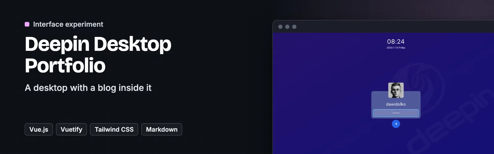
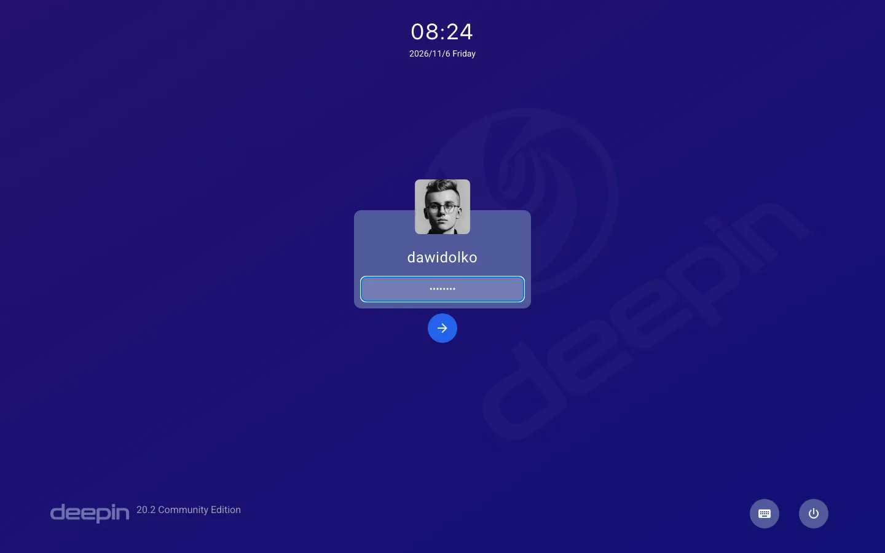
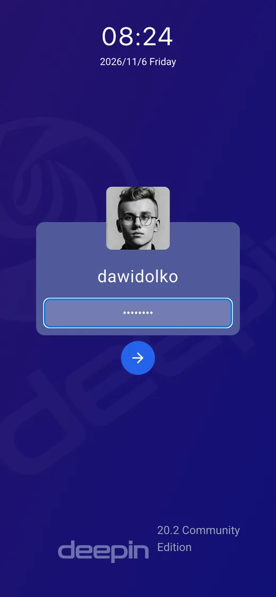

<p align="center">
  <a href="https://linux.dawidolko.pl/"></a>
</p>

# Deepin Desktop Portfolio

> 🐧 **A desktop with a blog inside it** — Deepin Linux rebuilt in Vue 2, with a terminal, a music player and markdown articles

**Based on [GoodManWEN.github.io](https://github.com/GoodManWEN/GoodManWEN.github.io) by [GoodManWEN](https://github.com/GoodManWEN), licensed under AGPL-3.0.** This repository is a modified version of that project and is released under the same licence. Most of the application code is his. See [what changed](#-changes-from-the-original). Not affiliated with Deepin; this is an interface imitation for portfolio purposes.

A portfolio and blog wearing the Deepin Linux desktop. Windows open, move, resize and layer as they do on the real system, and the applications are not decorative: a toy terminal, a music player, a recursive file system and a blog whose articles are markdown files rendered in a window.

Everything is pre-rendered into `/docs`, so the whole desktop — blog included — is a static site hosted free on GitHub Pages.


**[Live site](https://linux.dawidolko.pl/)** · [Screenshots](#️-screenshots) · [Getting started](#-getting-started)

---

## 🎯 Key Features

- **A blog that lives in a window** — articles are markdown files rendered by `markdown-it-vue`, so writing a post means adding a file.
- **A toy terminal** — commands, a prompt and a recursive file system behind it, rather than a static image of a shell.
- **A music player** — `vue-aplayer` inside one of the windows, with public domain recordings.
- **Real window management** — open, move, resize and layer, with the stacking order maintained.
- **Pre-rendered to static files** — the build lands in `/docs`, which GitHub Pages serves directly.
- **A generator script** — `generate.py` prepares the article index, so the blog does not need a backend to list itself.

---

## 🖼️ Screenshots

<p align="center">
  
  
</p>

---

## 🛠️ Technology Stack

| Technology | Version | Role |
| --- | --- | --- |
| **Vue.js** | 2.6 | The desktop, the windows and the apps. |
| **Vuetify** | — | UI components. |
| **Tailwind CSS** | 2 | Styling of the Deepin shell. |
| **Vue Router + Vuex** | — | Routing and shared state. |
| **Axios** | 0.21 | Fetching article content. |
| **markdown-it-vue** | 1.1 | Rendering the blog posts. |
| **vue-aplayer** | 1.6 | The music player. |

---

## 🚀 Getting Started

### Prerequisites

- Node.js 14 or newer
- npm

### 1. Clone the repository

```bash
git clone https://github.com/dawidolko/Linux-Simulaing-System-GUI.git
cd Linux-Simulaing-System-GUI
```

### 2. Install dependencies

```bash
npm install
```

### 3. Run

```bash
npm run serve   # development server at http://localhost:8080
npm run build   # static build into docs/, which is committed
npm run lint    # ESLint
```

---

## 📁 Project Structure

```
Linux-Simulaing-System-GUI/
├── blog/                # markdown articles
├── generate.py          # builds the article index
├── docs/                # the static build GitHub Pages serves
└── src/
    ├── App.vue          # the desktop shell
    ├── components/      # windows, terminal, player, file system
    ├── router/  store/  # routing and state
    ├── network/         # article fetching
    └── assets/
```

---

## 🖥️ The Family

This is one of four desktop-simulator portfolios, each built on a different stack:

| Desktop | Stack | Live |
| ------- | ----- | ---- |
| Windows 10 | React + Fluent UI | [windows.dawidolko.pl](https://windows.dawidolko.pl) |
| Ubuntu 20.04 | Next.js + Tailwind CSS | [ubuntu.dawidolko.pl](https://ubuntu.dawidolko.pl) |
| macOS | React + TypeScript + Vite | [macos.dawidolko.pl](https://macos.dawidolko.pl) |
| Deepin Linux | Vue 2 + Vuetify | [linux.dawidolko.pl](https://linux.dawidolko.pl) |

---

## ♿ Accessibility

An accessibility panel in the corner of every page changes text size, contrast, font and motion, and remembers the choice on the device. It sits on top of the markup and does not replace accessible markup.

---

## 🔀 Changes from the original

Modified by [Dawid Olko](https://dawidolko.pl) from March 2024, last changed in November 2026. Compared with the original project:

- Refactored and reformatted the window, folder, text, sidebar and store code, and fixed window dragging.
- Added the accessibility panel, reduced motion support, labels and a page heading.
- Added canonical and social tags, robots.txt, a sitemap, llms.txt and a 404 page.
- Self-hosted the fonts and icons, converted images to WebP and painted the login screen before mounting.
- Replaced the commercial music playlist and its covers with public domain recordings, and added an empty playlist state.
- Replaced the original author's profile, skills and CodeWars pages in the About window with this project's own.
- Added a credits page, a source link and licence notices in the interface, and pointed the context menu and the editor window at this repository.

The blog posts and the terminal prompt are still the original author's.

The full history is in the commit log.

---

## 📄 License

[GNU Affero General Public License v3.0](LICENSE).

Copyright (C) 2021 [GoodManWEN](https://github.com/GoodManWEN). Modifications copyright (C) 2024-2026 [Dawid Olko](https://dawidolko.pl). The source of the deployed site is this repository. Fonts, images and music keep their own terms, listed in [CREDITS.md](CREDITS.md).

---

## 👨‍💻 Author

**Dawid Olko** · Fullstack / AI Developer

[Portfolio](https://olkodawid.dawidolko.pl) · [CV](https://cv.dawidolko.pl) · [LinkedIn](https://www.linkedin.com/in/dawidolko/) · [GitHub](https://github.com/dawidolko)
